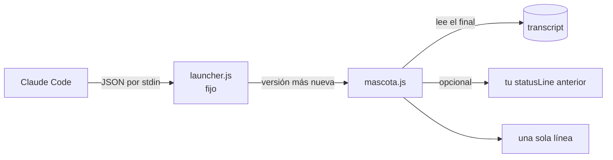

<div align="center">


# claude-mascotas

**Una gatita ASCII que te hace compañía en la statusLine de Claude Code.**<br>
Ocupa **una sola línea**. Siempre. Por diseño. Y cuando trabaja tu equipo de agentes, cada uno recibe su propio animalito con su nombre real.

  <a href="https://github.com/jfcarpiopuntocom/claude-mascotas/actions/workflows/test.yml"></a>
  
  
  
  
  <a href="LICENSE"></a>

[Instalar](#-instalar) · [Galería](#-galería) · [Elegir mascota](#-elegir-mascota) · [Preguntas](#-preguntas-que-nadie-hizo) · [English](https://github.com/jfcarpiopuntocom/claude-pets)

</div>

---

## 🐾 ¿Qué es?

Una mascota ASCII que vive en la statusLine de [Claude Code](https://code.claude.com) y reacciona a lo que pasa:

```
[Opus 5.5] │ mi-proyecto git:(main)
=^o^= trabajando...  @
Context ███░░░░░░░ 32%
```

| Cuando… | La gatita |
|---|---|
| no pasa nada | `=^.^= ronroneando` |
| Claude está trabajando | `=^o^= trabajando...` |
| trabaja tu equipo de agentes | `=^.^=/ 2 agentes trabajando  =^o^= estratega  =^O^= investigador` |
| algo falló | `=;.;= algo falló, revisa` |
| llevas rato sin escribir | `=-.-= z dormitando... zzz` |

Los cuadros se alternan cada segundo, así que **parpadea, respira y se duerme**.

## 🚀 Instalar

Dentro de Claude Code:

```
/plugin marketplace add jfcarpiopuntocom/claude-mascotas
/plugin install mascotas@claude-mascotas
/mascotas:setup
```

Reinicia Claude Code. Saluda a tu gatita.

<details>
<summary><b>¿No puedes escribir <code>/</code>?</b> (pasa con teclados en inglés y español a la vez)</summary>

Desde cualquier terminal:

```
claude plugin marketplace add jfcarpiopuntocom/claude-mascotas
claude plugin install mascotas@claude-mascotas
```

Luego abre Claude Code y pídele: *«ejecuta el comando setup de mascotas»*.

Y si la `/` desapareció de tu teclado: en Windows, **Win + Espacio** y elige el teclado en español.
</details>

### 🔄 Actualizaciones automáticas

`/plugin` → **Marketplaces** → `claude-mascotas` → **Enable auto-update**. Listo: cada animalito nuevo te llega solo. Tu statusLine apunta a un lanzador fijo que siempre ejecuta la versión más nueva instalada, así que nunca vuelves a configurar nada.

### 🤝 ¿Ya tenías otra statusLine?

`/mascotas:setup` la conserva (claude-hud, ccstatusline, la tuya…) y mete a la mascota como **una** línea justo debajo de la del modelo. Deja un respaldo de tu `settings.json`.

## 🖼️ Galería

24 para empezar. Esto es solo el principio.

<!-- galeria:start -->
| Mascota | Tranquila | Trabajando | Algo falló | Durmiendo | Clave |
|---|---|---|---|---|---|
| Gata | `=^.^=` | `=^o^=` | `=;.;=` | `=-.-= z` | `gata` |
| Perro | `U'.'U` | `U'o'U` | `U;.;U` | `U-.-U z` | `perro` |
| Búho | `{o,o}` | `{O,O}` | `{@,@}` | `{-,-} z` | `buho` |
| Dragón | `<^.^>~` | `<^o^>~~` | `<x.x>~` | `<-.->~ z` | `dragon` |
| Conejo | `(='.'=)` | `(='o'=)` | `(=;.;=)` | `(=-.-=) z` | `conejo` |
| Pingüino | `<('.')>` | `<('o')>` | `<(;.;)>` | `<(-.-)> z` | `pinguino` |
| Pez | `><(('>` | `><((o>` | `><((x>` | `><((-> z` | `pez` |
| Pulpo | `~(o.o)~` | `~(O.O)~` | `~(x.x)~` | `~(-.-)~ z` | `pulpo` |
| Ratón | `<:3 )~` | `<:o )~` | `<:x )~` | `<:- )~ z` | `raton` |
| Cerdo | `(^oo^)` | `(^OO^)` | `(xoox)` | `(-oo-) z` | `cerdo` |
| Rana | `(@..@)` | `(@oo@)` | `(x..x)` | `(-..-) z` | `rana` |
| Robot | `[o_o]` | `[O_O]` | `[x_x]` | `[-_-] z` | `robot` |
| Alien | `(@_@)` | `(@o@)` | `(x_x)` | `(-_-) z` | `alien` |
| Mono | `@('_')@` | `@('o')@` | `@(x_x)@` | `@(-_-)@ z` | `mono` |
| Oso | `c(^.^)c` | `c(^o^)c` | `c(x.x)c` | `c(-.-)c z` | `oso` |
| Pajarito | `(.>` | `(o>` | `(x>` | `(-> z` | `pajarito` |
| Pato | `__(.)<` | `__(o)<` | `__(x)<` | `__(-)< z` | `pato` |
| Cangrejo | `(\/)(o,,o)(\/)` | `(\/)(O,,O)(\/)` | `(\/)(x,,x)(\/)` | `(\/)(-,,-)(\/) z` | `cangrejo` |
| Murciélago | `/\(o.o)/\` | `/\(O.O)/\` | `/\(x.x)/\` | `\/(-.-)\/ z` | `murcielago` |
| Araña | `//(o.o)\\` | `//(O.O)\\` | `//(x.x)\\` | `//(-.-)\\ z` | `arana` |
| Oruga | `oooo(o.o)` | `oooo(O.O)` | `oooo(x.x)` | `oooo(-.-) z` | `oruga` |
| Serpiente | `~~~~:>` | `~~~~o>` | `~~~~x>` | `~~~~-> z` | `serpiente` |
| Fantasma | `(o.o)~` | `(O.O)~` | `(x.x)~` | `(-.-)~ z` | `fantasma` |
| Erizo | `;;;;(o.o)` | `;;;;(O.O)` | `;;;;(x.x)` | `;;;;(-.-) z` | `erizo` |
<!-- galeria:end -->

## 🎲 Elegir mascota

```
/mascotas:elegir              # muestra todas
/mascotas:elegir pulpo        # elige una
/mascotas:elegir azar         # que decida el destino
```

Tu equipo de agentes sale con la misma especie: si eliges pulpo, tu estratega es un pulpo. Como debe ser.

## 👥 Tu equipo de agentes

Cuando Claude lanza agentes, cada uno aparece con su **nombre o rol real** (el que les diste o su tipo), uno al lado del otro, en la misma línea. Cuando terminan, se van. Si hay más de 4, ves `+n`. Si la línea no cabe en tu terminal, se recorta con `…`: nunca ocupa dos líneas.

## ⚙️ Configuración

Opcional. Crea `~/.claude/plugins/claude-mascotas/config.json` (o dentro de tu `CLAUDE_CONFIG_DIR`). Sobrevive a las actualizaciones.

```json
{ "creature": "buho", "lang": "es", "color": true, "maxAgents": 4 }
```

| Opción | Qué hace | Por defecto |
|---|---|---|
| `creature` | la mascota (ver [Galería](#-galería)) | `gata` |
| `lang` | `es` o `en` | `es` |
| `color` | colores por estado | `true` |
| `maxAgents` | agentes visibles antes de `+n` | `4` |
| `firma.enabled` | el `@` con enlace al autor | `true` |
| `encadenar` | otra statusLine que se conserva | lo pone `setup` |

## 🧠 Cómo funciona



Sin dependencias, sin red, sin telemetría. Solo lee el final del transcript de tu sesión para saber si Claude trabaja, si algo falló o qué agentes están activos. Si algo sale mal, muestra `=^.^=` y sigue: **nunca rompe tu statusLine**.

## 🗺️ Hoja de ruta

- [x] Gatita de una sola línea
- [x] Un animalito por agente, con su nombre real
- [x] 24 mascotas y `/mascotas:elegir`
- [x] Actualizaciones automáticas
- [ ] Docenas más (¿cuál falta? [pídela](https://github.com/jfcarpiopuntocom/claude-mascotas/issues/new?template=nueva-mascota.yml))
- [ ] Mascotas de temporada
- [ ] Estados de ánimo por hora del día

## ❓ Preguntas que nadie hizo

**¿Por qué existe esto?** Fue un proyecto paralelo para aprender a usar Claude Code. Se nos fue un poco de las manos.

**¿Cuánto cuesta?** Nada. Puedes evaluarla 40 días gratis, y después también.

**¿Puede ocupar dos líneas?** No. Es una gata, no una novela.

**¿Funciona en Windows, macOS y Linux?** Sí. Solo necesita Node, que Claude Code ya trajo a tu vida.

**¿Hace algo útil?** Te avisa cuándo Claude trabaja, cuándo algo falló y quién de tu equipo sigue activo. Y te acompaña. Eso cuenta.

**¿English?** Yes: [claude-pets](https://github.com/jfcarpiopuntocom/claude-pets).

## 🤝 Contribuir

¿Tu animal favorito no está? Mira [CONTRIBUTING.md](CONTRIBUTING.md): agregar una mascota son 5 líneas de JSON.

## 📄 Licencia

[MIT](LICENSE). Úsala, cámbiala, compártela.

---

<div align="center">

<sub>by J.F.Carpio — <a href="https://jfcarpio.com">jfcarpio.com</a> — for Avatiun Consultores</sub><br>
<sub><code>=^.^=</code> «para siempre» sujeto a que los gatos sigan existiendo.</sub>

</div>
