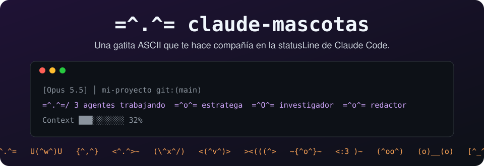
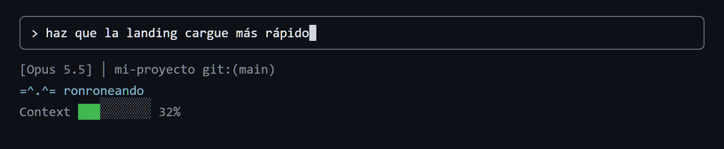
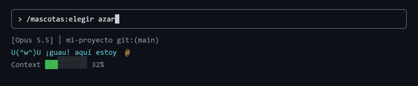
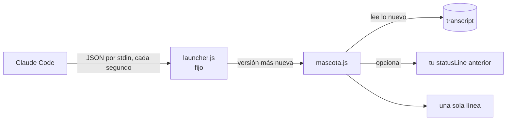

<div align="center">



# claude-mascotas

**Una gatita ASCII que te hace compañía en la statusLine de Claude Code.**<br>
Ocupa **una sola línea**. Siempre. Por diseño. Y cuando trabaja tu equipo de agentes, cada uno sale a su lado con su nombre real.

  <a href="https://github.com/jfcarpiopuntocom/claude-mascotas/actions/workflows/test.yml"></a>
  
  
  
  
  <a href="LICENSE"></a>

[Instalar](#instalar) · [Galería](#galeria) · [Elegir mascota](#elegir) · [Preguntas](#preguntas) · [English](https://github.com/jfcarpiopuntocom/claude-pets)

</div>

---

## 🐾 ¿Qué es?

Una mascota ASCII que vive en la statusLine de [Claude Code](https://code.claude.com) y reacciona a lo que pasa:

<p align="center"></p>

| Cuando… | La gatita |
|---|---|
| no pasa nada | `=^.^= ronroneando` |
| Claude está trabajando | `=^o^= trabajando...` |
| trabaja tu equipo de agentes | `=^.^=/ 2 agentes trabajando  =^o^= estratega  =^O^= investigador` |
| la última herramienta falló | `=;.;= algo falló, revisa` |
| llevas rato sin escribir | `=-.-= Zzz dormitando...` |

Se mueve sola: `setup` le pide a Claude Code que la redibuje cada segundo, así que **parpadea, respira y se duerme**.

<a id="instalar"></a>
## 🚀 Instalar

Dentro de Claude Code:

```
/plugin marketplace add jfcarpiopuntocom/claude-mascotas
/plugin install mascotas@claude-mascotas
/mascotas:setup
```

Saluda a tu gatita.

<details>
<summary><b>¿Prefieres la terminal?</b></summary>

```
claude plugin marketplace add jfcarpiopuntocom/claude-mascotas
claude plugin install mascotas@claude-mascotas
```

Luego abre Claude Code y pídele: *«ejecuta el comando setup de mascotas»*.

¿Tu teclado no escribe `/`? Si en Windows tienes teclado en inglés y en español, presiona **Win + Espacio** y elige el español.
</details>

<details>
<summary><b>¿Venías de <code>mascota-statusline</code>?</b></summary>

Cambió de nombre. Instala con los tres comandos de arriba: `/mascotas:setup` conserva la statusLine que tenías.
</details>

### 🔄 Actualizaciones automáticas

Un interruptor, una sola vez: `/plugin` → **Marketplaces** → `claude-mascotas` → **Enable auto-update**. Desde ahí cada mascota nueva te llega sola. Tu statusLine apunta a un lanzador fijo que siempre ejecuta la versión más nueva instalada, así que nunca vuelves a configurar nada.

### 🤝 ¿Ya tenías otra statusLine?

`/mascotas:setup` la conserva (claude-hud, ccstatusline, la tuya…) y mete a la mascota como **una** línea justo debajo de la del modelo. Guarda un respaldo de tu `settings.json` la primera vez y nunca lo pisa. Si tu statusLine tarda más de 4 s, la mascota sale sola en ese momento en vez de congelarse (ajustable con `chainTimeoutMs`).

### 👋 Desinstalar

```
/mascotas:quitar
/plugin uninstall mascotas@claude-mascotas
```

`/mascotas:quitar` devuelve la statusLine que tenías antes. Tu mascota elegida queda guardada por si vuelves.

<a id="galeria"></a>
## 🎨 Galería

24 para empezar. Esto es solo el principio.

<p align="center"></p>

<!-- galeria:start -->
| Mascota | En calma | Trabajando | Algo falló | Durmiendo | Clave |
|---|---|---|---|---|---|
| **Gata** | `=^.^=` <sub>ronroneando</sub> | `=^o^=` | `=;.;=` | `=-.-= Zzz` | `gata` |
| **Perro** | `U(^w^)U` <sub>¡guau! aquí estoy</sub> | `U(*w*)U!` | `U(;w;)U` | `U(-w-)U Zzz` | `perro` |
| **Búho** | `{^,^}` <sub>uhh-uhh...</sub> | `{O,O}` | `{@,@}` | `{-,-} Zzz` | `buho` |
| **Dragón** | `<^.^>~` <sub>cuidando el tesoro</sub> | `<^O^>==*` | `<@.@>~` | `<-.->~ Zzz` | `dragon` |
| **Conejo** | `(\^x^/)` <sub>oreja atenta</sub> | `(\OxO/)` | `(\;x;/)` | `(\-x-/) Zzz` | `conejo` |
| **Pingüino** | `<(^v^)>` <sub>de frac y listo</sub> | `<(OvO)>` | `<(;v;)>` | `<(-v-)> Zzz` | `pinguino` |
| **Pez** | `><(((^>` <sub>blub, nadando...</sub> | `><(((*> o` | `><(((x>` | `><(((-> Zzz` | `pez` |
| **Pulpo** | `~{^o^}~` <sub>ocho brazos libres</sub> | `~{>o<}~~` | `~{x_x}~ :::` | `~{-o-}~ Zzz` | `pulpo` |
| **Ratón** | `<:3 )~` <sub>squik, ¿queso?</sub> | `<:3 )~ ==` | `<;3 )~` | `<-3 )~ Zzz` | `raton` |
| **Cerdo** | `(^oo^)` <sub>oink, todo bien</sub> | `(>OO<)` | `(TooT)` | `(-oo-) Zzz` | `cerdo` |
| **Rana** | `(o)__(o)` <sub>croac, tranquila</sub> | `(o)__(o)-----*` | `(;)__(;)` | `(-)__(-) Zzz` | `rana` |
| **Robot** | `[^_^]` <sub>bip bup, en línea</sub> | `[0_1]` | `[x_x]~` | `[-_-] Zzz` | `robot` |
| **Gatito otaku** | `(=^w^=)` <sub>nyaa~</sub> | `(=>w<=)` | `(=XwX=)` | `(=-w-=) Zzz` | `otaku` |
| **Mono** | `@('_')@` <sub>uh-uh, ¿banana?</sub> | `@(*o*)@` | `@(;_;)@` | `@(-_-)@ Zzz` | `mono` |
| **Oso** | `c(^(I)^)c` <sub>abrazo de oso</sub> | `c(*(I)*)c` | `c(T(I)T)c` | `c(-(I)-)c Zzz` | `oso` |
| **Pajarito** | `(^>` <sub>pío pío~</sub> | `\(o>` | `(x>` | `(-> Zzz` | `pajarito` |
| **Pato** | `__(.)<` <sub>cuac, flotando</sub> | `~__(o)<` | `__(x)<` | `__(-)< Zzz` | `pato` |
| **Cangrejo** | `(\/)(^,,^)(\/)` <sub>clac clac, de lado</sub> | `(\/)(O,,O)(\/)` | `(\/)(;,,;)(\/)` | `(V)(-,,-)(V) Zzz` | `cangrejo` |
| **Murciélago** | `/\(^.^)/\` <sub>volando de noche</sub> | `/\(>.<)/\` | `/\(x.x)/\` | `\/(-.-)\/ Zzz` | `murcielago` |
| **Araña** | `/\/(^^^^)\/\` <sub>en su telaraña</sub> | `/\/(OOOO)\/\` | `/\/(xxxx)\/\` | `/\/(----)\/\ Zzz` | `arana` |
| **Oruga** | `oOoO('u')` <sub>ñam, una hojita</sub> | `oOoO(OuO)` | `oooo(;u;)` | `oooo(-u-) Zzz` | `oruga` |
| **Serpiente** | `~~~~:>` <sub>sss, al sol</sub> | `~/\/\/:>` | `~~~~x>` | `@@~-> Zzz` | `serpiente` |
| **Fantasma** | `~~(O.O)` <sub>flotando, uuuh</sub> | `~~(OoO) boo!` | `~~(x.x)` | `~~(-.-) Zzz` | `fantasma` |
| **Erizo** | `MMMM(^.^)` <sub>husmeando, snif</sub> | `MMMM(>.<)` | `MMMM(;.;)` | `MMMM(-.-) Zzz` | `erizo` |
<!-- galeria:end -->

<a id="elegir"></a>
## 🎲 Elegir mascota

```
/mascotas:elegir              # muestra todas
/mascotas:elegir pulpo        # elige una (con o sin tildes: búho, buho)
/mascotas:elegir azar         # que decida el destino
```

Tu equipo de agentes sale con la misma especie: si eliges pulpo, tu estratega es un pulpo. Como debe ser.

## 👥 Tu equipo de agentes

Cuando Claude lanza agentes, cada uno aparece con su **nombre o rol real** (el que le diste o su tipo), uno al lado del otro, en la misma línea. Cuando terminan, se van. La mascota los recuerda aunque la sesión sea larguísima. Si no caben todos, ves `+n`, y si aun así la línea no cabe, se recorta con `…`: **nunca ocupa dos líneas**.

## 🔧 Configuración

Opcional. Crea `~/.claude/plugins/claude-mascotas/config.json` (o dentro de tu `CLAUDE_CONFIG_DIR`). Sobrevive a las actualizaciones y puedes poner solo lo que quieras cambiar.

```json
{ "creature": "buho", "lang": "es", "color": true, "maxAgents": 4 }
```

| Opción | Qué hace | Por defecto |
|---|---|---|
| `creature` | la mascota (ver [Galería](#galeria)) | `gata` |
| `lang` | `es` o `en` | `es` |
| `color` | colores por estado | `true` |
| `maxAgents` | agentes visibles antes de `+n` | `4` |
| `maxWidth` | ancho máximo si tu terminal no lo informa | `100` |
| `chain` | tu statusLine anterior, que se conserva | lo pone `setup` |
| `chainTimeoutMs` | cuánto esperar a tu statusLine anterior | `4000` |


## 🧠 Cómo funciona



Sin dependencias, sin red, sin telemetría. Lee solo lo que se agregó al transcript de tu sesión desde la última vez (y anota en un archivito por sesión qué agentes siguen activos) para saber si Claude trabaja, si la última herramienta falló o quién de tu equipo sigue ocupado. Si algo sale mal, muestra `=^.^=` y sigue: **nunca rompe tu statusLine**.

## 🗺️ Hoja de ruta

- [x] Gatita de una sola línea
- [x] Un animalito por agente, con su nombre real
- [x] 24 mascotas y `/mascotas:elegir`
- [x] Actualizaciones automáticas
- [ ] Docenas más (¿cuál falta? [pídela](https://github.com/jfcarpiopuntocom/claude-mascotas/issues/new?template=nueva-mascota.yml))
- [ ] Mascotas de temporada
- [ ] Estados de ánimo por hora del día

<a id="preguntas"></a>
## ❓ Preguntas que nadie hizo

**¿Por qué existe esto?** Fue un proyecto personal para aprender a usar Claude Code. Se nos fue un poco de las manos.

**¿Cuánto cuesta?** Nada. Puedes evaluarla 40 días gratis, y después también.

**¿Puede ocupar dos líneas?** No. Es una gata, no una novela.

**¿Funciona en Windows, macOS y Linux?** Sí, y lo prueban en los tres en cada cambio. Solo necesita Node.

**¿Hace algo útil?** Te avisa cuándo Claude trabaja, cuándo algo falló y quién de tu equipo sigue activo. Y te acompaña. Eso cuenta.

**¿English?** Yes: [claude-pets](https://github.com/jfcarpiopuntocom/claude-pets).

## 🤝 Contribuir

¿Tu animal favorito no está? Mira [CONTRIBUTING.md](CONTRIBUTING.md): agregar una mascota son 5 líneas de JSON.

## 📄 Licencia

[MIT](LICENSE). Úsala, cámbiala, compártela.

---

<div align="center">

<sub>by J.F.Carpio — <a href="https://jfcarpio.com">jfcarpio.com</a> — for Avatiun Consultores</sub><br>
<sub><code>=^.^=</code> «para siempre» sujeto a que los gatos sigan existiendo.</sub>

</div>
